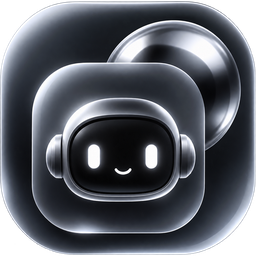
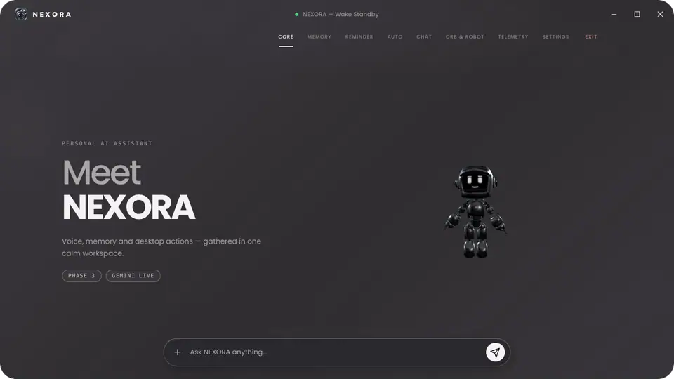
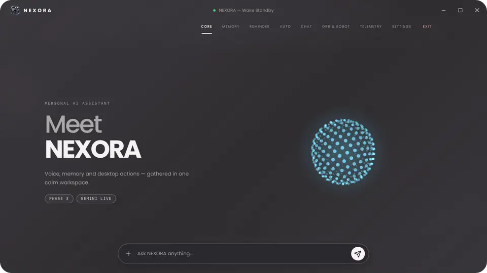
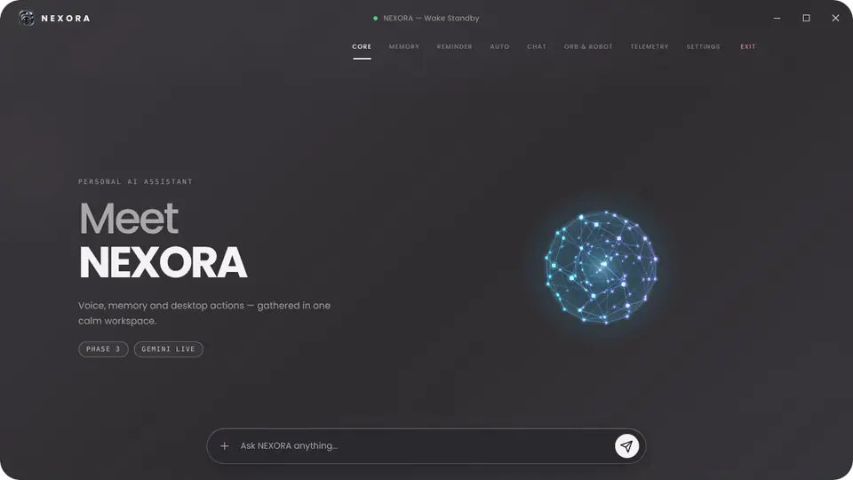
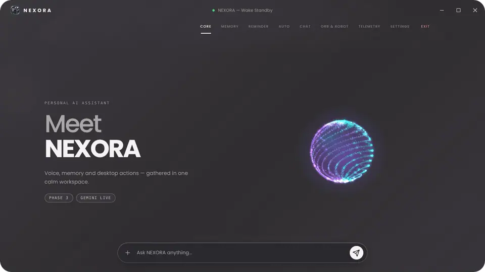

<p align="center">
  
</p>

<h1 align="center">NEXORA</h1>

<p align="center">
  <a href="docs/art/hero-robot.webm"></a>
</p>

<p align="center"><sub>Screen recording of the real NEXORA app. Click for the full-quality video.</sub></p>

<p align="center"><strong>A little AI buddy that lives on your screen, hears its name, talks back and gets things done.</strong></p>

<p align="center">
  
  
  
  
  
</p>

> **NEXORA**: Next-Generation Experience, eXecution, Orchestration, Reasoning & Artificial Intelligence

NEXORA is an AI buddy for your desktop. It floats on your screen as a glowing orb or a 3D robot, waits quietly until you say its name, answers out loud in a natural voice, remembers what matters to you, reminds you on time and can open apps, folders and links for you.

**Owner:** codewithsempai_daya

## Why NEXORA

- **Just say its name.** Say "Hey Nexora", "Nexora", "Hey Nexo" or "Nexo". Wake-word detection runs **offline** on your PC, so nothing is sent anywhere while it waits.
- **Talk, don't type.** Real-time voice conversation through Gemini Live. You can interrupt it mid-sentence, and saying "mute" sends it back to standby.
- **It talks back.** Natural spoken replies in the Gemini **Charon** voice, with lip sync on the robot.
- **It remembers.** An encrypted Memory Vault holds your preferences, facts, projects and notes. You see memories being saved live and nothing is removed without your say-so.
- **It reminds you.** Say "remind me at 6 to call mom" in plain words and NEXORA sets it, then nudges you with snooze, tomorrow or done.
- **It does the clicking.** Opens any installed app, folder, drive or link by name, creates folders, extracts zips and plans multi-step tasks. Every action asks first, by default.
- **It sees your screen when you ask.** Say "explain my screen" or press **Ctrl+Shift+E**. It looks at all monitors, or just the one you name ("my Chrome screen").
- **Bring your own key.** NEXORA has no account, no server and no analytics. It talks straight to Google with **your** Gemini API key.

## Pick your orb

Four looks, one assistant. Switch any time in **ORB & ROBOT**. Every recording on this page is the real app.

**NEXORA Robot** is the one in the video at the top: a 3D robot with 22 expressions, face effects and lip sync driven by its real voice. The three particle orbs are below.

<table>
  <tr>
    <td align="center" width="33%"><a href="docs/art/hero-nexora.webm"></a></td>
    <td align="center" width="33%"><a href="docs/art/hero-nexo.webm"></a></td>
    <td align="center" width="33%"><a href="docs/art/hero-nexie.webm"></a></td>
  </tr>
  <tr>
    <td align="center" valign="top"><strong>NEXORA</strong><br><sub>The original particle sphere: a golden-spiral cloud of points that ripples as it speaks</sub></td>
    <td align="center" valign="top"><strong>NEXO</strong><br><sub>Neural Sphere: glowing links between nodes that pulse with thought</sub></td>
    <td align="center" valign="top"><strong>NEXIE</strong><br><sub>Particle Flow: streams of light that swirl around the core</sub></td>
  </tr>
</table>

Every orb reacts to seven states: **idle, listening, thinking, speaking, wake, offline and error**. The floating wake popup is resizable, and the orb can sit on your screen at its own size.

## NEXORA shows its work

Ask NEXORA to do something and it shows a short plan card at the top-right of your screen. You press **Run**, each step follows its permission level, and a failed step offers **Retry**, **Skip** or **Stop**. Say "Nexora, stop" any time.

Permission levels are set per action: ask every time, ask once per session, always allow, or never allow. When a card asks, you can answer by voice ("OK", "always allow", "no") without touching the mouse.

## Also included

- **Frosted glass desktop UI:** a frameless window with tabs for Core, Memory, Reminder, Chat, Orb, Auto, Telemetry and Settings.
- **Morning brief and nudges:** one card a day with today's reminders and your latest project, plus gentle follow-ups on snoozed reminders.
- **Watchers (optional):** new zip in Downloads, low battery, low disk space and copied error text. Each one only offers help, it never acts on its own.
- **Memory upkeep:** merges duplicates, retires old chat notes and writes a daily summary.
- **Smart model ladder:** NEXORA lists the Gemini models your key can use, lets you pick text and Live models, and falls back automatically if one is busy or out of quota.
- **Telemetry:** live CPU, memory and latency charts, service health and a system log.
- **Original sound design:** ten synthesized sound effects, no audio files bundled.
- **Rust native core:** math, voice analysis and system diagnostics in a small sidecar.
- **Safe by default:** sandboxed renderer, validated IPC, a fixed catalogue of computer actions, hourly caps, and no free-form shell commands.

| | Windows | macOS | Linux |
| --- | --- | --- | --- |
| Desktop app | Yes, Windows 10 and 11 | Planned | Not yet |
| Wake word (offline) | Yes | Planned | Not yet |
| Live voice and spoken replies | Yes | Planned | Not yet |
| Memory and reminders | Yes | Planned | Not yet |
| Open apps, folders and links | Yes | Planned | Not yet |
| Explain my screen | Yes, all monitors | Planned | Not yet |
| Show or hide | Ctrl+Shift+Space | Planned | Not yet |
| Explain my screen shortcut | Ctrl+Shift+E | Planned | Not yet |

macOS support is in design: see `platforms/apple/`.

## Updates

**Update notice:** installed builds check GitHub Releases for updates. When a newer version exists NEXORA shows a "New NEXORA update" notice with **View release**, **Later** and **Skip this version**, and you install it manually. Nothing is downloaded or installed automatically. It can be switched off in **Settings -> Support & Updates**, and `PRIVACY.md` discloses it. You can also press **Check now** in the same place.

## Get started

1. Install [Node.js](https://nodejs.org) 20 or newer.
2. Get a free Gemini API key from [Google AI Studio](https://aistudio.google.com/apikey).
3. Run NEXORA:

   ```
   npm install
   npm start
   ```

   Or straight from Cargo, which installs Electron on the first run:

   ```
   cargo run -- --desktop
   ```

4. Open **Settings → Gemini**, paste your key and save. It is stored encrypted with your operating system's secure storage.
5. Turn on **Wake standby** in Settings, then say "Hey Nexora".

If Electron's install script is blocked on your machine, run `node node_modules/electron/install.js` once.

**Development:**

```
npm run dev                                          # app with dev flags
npm test                                             # JavaScript test suites
cargo test --manifest-path native/rust/Cargo.toml    # Rust core tests
npm run build:rust:debug                             # build the native sidecar
npm run hero                                         # re-record the four screen recordings in docs/art/ from the real app
```

## Project structure

```
nexora/
├── src/
│   ├── main/        # Electron main process: app lifecycle, IPC, Gemini, Live voice, wake word, memory, reminders, autonomy
│   ├── preload/     # Secure context bridge (window.nexoraAPI) and channel whitelists
│   └── renderer/    # Sandboxed UI: orb engines, robot, chat, memory, reminders, settings, telemetry
├── native/rust/     # Rust native core (sidecar)
├── platforms/apple/ # Future macOS modules
├── assets/          # Icons, 3D robot, wake-word models
├── tools/           # build-robot-asset.js, record-hero.js (records the README screen recordings with Playwright)
├── docs/            # Autonomy guide, Robot Orb, architecture, history
└── tests/unit/      # Unit tests
```

More: [`docs/AUTONOMY_GUIDE.md`](docs/AUTONOMY_GUIDE.md) · [`docs/ROBOT_ORB.md`](docs/ROBOT_ORB.md) · [`docs/architecture/phase1.md`](docs/architecture/phase1.md)

## Privacy

NEXORA has no analytics and the developer collects nothing. Your messages, Live voice audio and screenshots (only when you ask) go to Google's Gemini API using your own key. Wake-word detection stays on your PC. [PRIVACY.md](PRIVACY.md) lists exactly what is sent and what is stored.

## Uninstall

1. Quit NEXORA from the system tray.
2. Delete the NEXORA folder you cloned or unzipped.
3. Delete your data folder: `%APPDATA%\nexora`. This removes your settings, encrypted key, memory vault, reminders and action log.
4. Revoke the API key in Google AI Studio if you no longer want it active.

## License

NEXORA is free software under the [GNU Affero General Public License v3.0](LICENSE) (AGPL-3.0-or-later). You can use it, study it, change it and share it. If you distribute your changes, or let other people use a modified version over a network, you must share its complete source code under the same license. See [NOTICE](NOTICE) for the copyright notice and third-party components.

The NEXORA name and logo are not covered by the license. If you publish a modified version, please give it a different name.

## Contributing

Bug reports, ideas and pull requests are welcome. [Open an issue](../../issues) to get started, read [CONTRIBUTING.md](CONTRIBUTING.md) before a pull request, and report security problems privately as described in [SECURITY.md](SECURITY.md).

---

Copyright © 2026 codewithsempai_daya. Licensed under AGPL-3.0-or-later.
